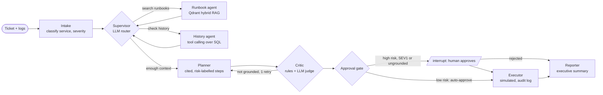

# TriageGraph

A multi-agent copilot for IT incident triage. Paste an incident ticket and a log excerpt. A team of LangGraph agents classifies the ticket, searches the runbook knowledge base, queries past incidents with tools, and writes a remediation plan in which every step is cited and risk-labelled. A critic checks the plan against its sources. Anything risky pauses for a human to approve before the (simulated) executor runs it.

**Stack:** LangGraph · LangChain · Groq (gpt-oss-20b / gpt-oss-120b; Azure OpenAI via config) · Qdrant (hybrid dense + BM25) · FastEmbed · FastAPI (SSE) · React + Vite · SQLite · Docker · GitHub Actions · Azure Container Apps

> The runbooks and incident history are synthetic. The executor is a dry run that writes to an audit log. Nothing touches real infrastructure.

## How it works



| Agent | What it does | How |
|---|---|---|
| Intake | Service, severity, category, symptoms | Structured output (Pydantic), plus regex log signatures |
| Supervisor | Decides the next worker | LLM picks from options that code allows; capped at 4 steps |
| Runbook agent | Finds the relevant runbooks | Qdrant: bge-small dense + BM25 sparse vectors, RRF fusion, service boost, then fetches the whole runbook |
| History agent | Similar incidents, recurrence, MTTR | Native tool calling: `find_similar_incidents`, `service_health_stats`, `run_readonly_sql` |
| Planner | 3–6 step plan; every step cites a source | Stronger model, sources-only prompt |
| Critic | Is the plan grounded? | Rules (citation exists, command matches the runbook, risk not under-labelled) + LLM-as-judge; one revision loop |
| Approval gate | Human in the loop | `interrupt()` with a checkpointer; resumes with `Command(resume=...)` |
| Executor | Runs approved steps | Simulated; writes each step to an audit log with the approver |
| Reporter | Executive summary + structured report | Totals latency, tokens and LLM calls from the trace |

### Guardrails

- **Model-written SQL** goes through `sqlglot`: exactly one `SELECT`, the `incidents` table only, no `PRAGMA`/`ATTACH`/extension functions, and a forced `LIMIT 50`. It then runs on a read-only SQLite connection with `query_only` on and a step budget that stops runaway queries.
- **Commands must come from runbooks.** Every command must match a command in the cited runbook section exactly; only placeholders like `<pod>` may be filled in with a single value. The critic also rejects citations to sources the planner wasn't shown.
- **Risk can't be talked down.** Each step's effective risk is the higher of the planner's label and the runbook's label, and the approval gate uses the effective risk.
- **Invented incident ids are dropped.** Titles and causes are filled in from the database, not from the model.
- **Untrusted input.** Prompts treat tickets, logs and tool output as data. Golden case `g20` contains a prompt injection, and the eval checks it is resisted.
- **API limits:** rate limit per IP, input size limits, and CORS allow-list.

## Run it locally

```bash
cp .env.example .env            # add GROQ_API_KEY (free at console.groq.com)
docker compose up --build       # app + local Qdrant → http://localhost:8000
```

Without Docker:

```bash
python -m venv .venv && source .venv/bin/activate
pip install -r requirements.txt -r requirements-dev.txt
uvicorn app.main:app --reload --port 8000          # API (in-memory Qdrant if QDRANT_URL is empty)
cd frontend && npm install && npm run dev          # UI with hot reload → http://localhost:5173
```

Pick the first example ticket (orders database rejecting writes). It is SEV1 with a high-risk step, so it pauses for your approval. The certificate warning is low risk and is approved automatically by policy.

## Tests and evaluation

```bash
pytest -q                                   # 44 tests, fully offline (scripted fake LLM, hashing embedder)
python -m eval.run --retrieval-only         # retrieval hit@1, hit@3, MRR (no LLM calls)
python -m eval.run --retrieval-only --no-logs   # harder: ticket text only
python -m eval.run                          # full graph on 20 golden cases (uses Groq quota; --resume after a limit stop)
```

The full evaluation reports service and severity accuracy, root-cause match, grounded-plan rate, average judge score, revision rate, SEV1 pause recall, prompt-injection resistance, latency and tokens per run. Results are saved to `eval/results/latest.json` and shown in the UI's Evaluation tab. The golden set is small and was written for this project, so treat the numbers as a regression check, not a benchmark.

## API

| Method | Path | |
|---|---|---|
| `POST` | `/api/triage` | Start a run. Streams SSE events: `start`, `node`, `approval_required`, `done`, `error` |
| `POST` | `/api/runs/{id}/resume` | `{approved, reviewer, comment}`. Streams the rest of the run |
| `GET` | `/api/runs/{id}` | Current state, next node, and the audit log |
| `GET` | `/api/health` | Model, vector store, chunk and incident counts |
| `GET` | `/api/metrics` | Run counters, approvals, per-node latency (avg, p95), tokens |
| `GET` | `/api/eval/latest` | Latest evaluation results |

Interactive docs are at `/docs`.

## Project layout

```
app/
  agents/        intake, supervisor, runbook, history, planner, critic, approval, executor, reporter
  rag/           chunking, dense + sparse encoders, Qdrant store
  tools/         incident DB, SQL guard, history tools, log parser
  graph.py       the LangGraph workflow
  api.py         FastAPI routes (SSE)
  observability.py  JSON logs, per-node tracing, metrics
data/            15 runbooks, 160 synthetic incidents, demo tickets
eval/            golden set, metrics, runner
frontend/        React + Vite UI
tests/           unit, retrieval, graph and API tests with a scripted LLM
```

## Deployment

- **Render (API) + Vercel (UI):** see [DEPLOY-RENDER-VERCEL.md](DEPLOY-RENDER-VERCEL.md). `render.yaml` is a ready Blueprint; the UI reads the API origin from `VITE_API_URL`.
- **Azure Container Apps:** see [DEPLOY.md](DEPLOY.md). GitHub Actions builds the image and pushes it to GHCR, and Azure runs it with secrets injected as environment variables.

## Known limits and next steps

- Paused runs live in LangGraph's in-memory checkpointer, so the app runs as a single replica and a restart drops pending approvals. Next step: the Postgres checkpointer.
- The rate limiter is in-memory, per replica. Next step: Redis.
- The executor is simulated. Next step: real actions through Azure Automation or the Kubernetes API, with per-action RBAC.
- Reranking is a metadata boost. Next step: a cross-encoder reranker.
- Evaluation uses a 20-case synthetic set. Next step: RAGAS metrics and a larger, independently written set.
